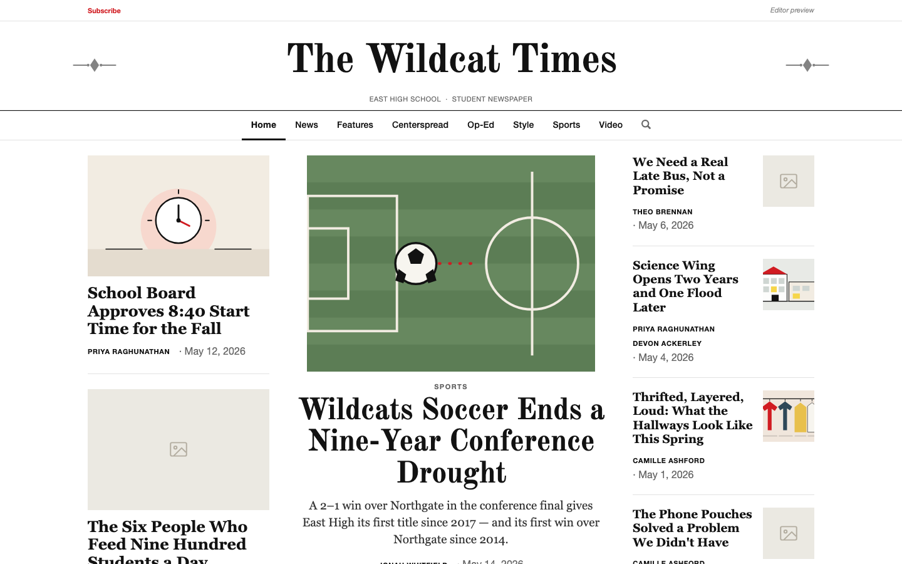
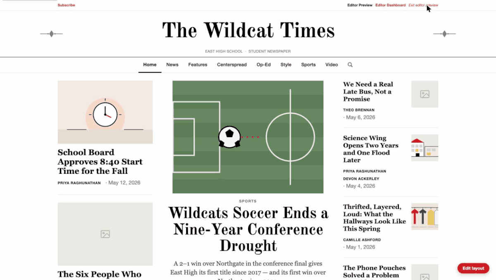

# First Edition

A free, open-source website for student newspapers. Plain HTML, CSS and
JavaScript, no build step, no dependencies, editor dashboard built in.

[](https://github.com/ariel-378/First-Edition/actions/workflows/tests.yml)
[](LICENSE)
[](https://ariel-378.github.io/First-Edition/)



School newspapers mostly live on paid hosted platforms (typically a few hundred
dollars a year plus a setup fee) or on self-managed WordPress installs that
break when a plugin updates. First Edition is the third option: a complete
newspaper site with an editor dashboard, in plain HTML, CSS and JavaScript,
with no build step and no dependencies to rot. It runs on GitHub Pages for
free or inside the website platform your school already pays for.

## Quick start

1. Click **Use this template** at the top of this page and create your repo.
2. In your new repo: **Settings → Pages → Source: GitHub Actions.** The included
   workflow deploys `site/` on every push. Your paper is live at
   `https://<you>.github.io/<repo>/` in about a minute.
3. Edit `site/config.js` (paper name, school, colors) — or open the site, click
   **Editor preview**, use the **Brand design** tab, and export `config.js`.

## Live demo

**<https://ariel-378.github.io/First-Edition/>** runs with no host platform
behind it, so you can open the editor yourself: click **Editor preview** in the
account bar. Your changes stay in your own browser; **Reset all demo data** puts
everything back.

## What's in the box

- **Editor dashboard** — articles, sections, staff, sports with brackets,
  videos, puzzles & games, all without touching code.
- **Editor-managed sections** — add, rename and reorder sections; nav, section
  pages, home page and search follow automatically.
- **Plan an edition ahead** — every piece of content takes a publish time and
  stays invisible until it arrives; a Schedule tab shows the whole plan.
- **Links that preview** — every published story is also a real static page,
  so it previews with headline and photo in iMessage, Slack and social posts.
- **Brand in one file** — `site/config.js` sets the masthead, school, colors,
  logo and footer everywhere; the dashboard can export it for you.
- **Host-ready** — designed to sit behind a school platform such as Finalsite,
  which provides login and decides who is an editor. Optional shared editing
  for papers running on their own.
- **Bring your archive** — a WordPress or SNO export imports in one command,
  stories, bylines, dates, tags and lead photos included.



## Deploy

- **GitHub Pages** — built in; see Quick start.
- **Any static host** — upload the contents of `site/`. That is the whole deploy.
- **Inside your school's platform** — see [docs/FINALSITE.md](docs/FINALSITE.md)
  and [docs/INTEGRATION.md](docs/INTEGRATION.md).

## Who uses it

- **The Woodley Leaves**, Maret School (Washington, DC) — approved by the
  school; Finalsite deployment in progress.

Running First Edition at your school? Open an issue and it will be added here.

## Tests

```bash
npm ci
npm test
```

1093 checks across 25 suites: every page loads clean, every editor control is
pressed without throwing, and content added in the editor reaches the reader
pages. See [tests/README.md](tests/README.md).

## Documentation

- [docs/ADVISER.md](docs/ADVISER.md) — for the journalism teacher: what it is,
  what it costs, what you need. No code.
- [docs/DEVELOPER.md](docs/DEVELOPER.md) — run it locally, project layout, link
  previews, why there is no framework.
- [docs/FINALSITE.md](docs/FINALSITE.md) — the identity contract and a phased
  plan for running inside Finalsite.
- [docs/CUSTOMIZE.md](docs/CUSTOMIZE.md) — rebrand the paper for your school.
- [docs/INTEGRATION.md](docs/INTEGRATION.md) — for the host platform's
  administrator: where content lives and a setup checklist.
- [docs/CODE-GUIDE.md](docs/CODE-GUIDE.md) — a developer's tour of the code.

## Cite this

[](https://doi.org/10.5281/zenodo.23445561)

Software: Pollard, A. L. (2026). *First Edition* (Version 1.0.1) [Computer software].
Zenodo. https://doi.org/10.5281/zenodo.23445562

Report (design, architecture, tests, measurements): Pollard, A. L. (2026). *First Edition:
a zero-build publishing platform for student newspapers* [Preprint]. Zenodo.
https://doi.org/10.5281/zenodo.23455214

GitHub's **Cite this repository** button (right sidebar) gives the same reference in APA
and BibTeX from `CITATION.cff`.

## How this was built

I designed and wrote First Edition starting in July 2026, while rebuilding my
school paper's website. I used Claude Code as a pair-programmer on about two
in five commits, across features, fixes and documentation; the commit history
records which ones. The architecture (no framework, no build step, a store
layer that a host platform can back), the editor, the Finalsite integration,
and every editorial decision are mine.

## Contributing, security, licence

Contributions are welcome: see [CONTRIBUTING.md](CONTRIBUTING.md) and the
[code of conduct](CODE_OF_CONDUCT.md). Security reports go through GitHub's
private reporting, not a public issue: see [SECURITY.md](SECURITY.md).

[MIT](LICENSE) — take it, rename it, run your own paper on it. No attribution
required in the site itself, though a line in your colophon is welcome. The
sample content (East High School, The Wildcat Times, every byline and score)
is invented and covered by the same licence.
